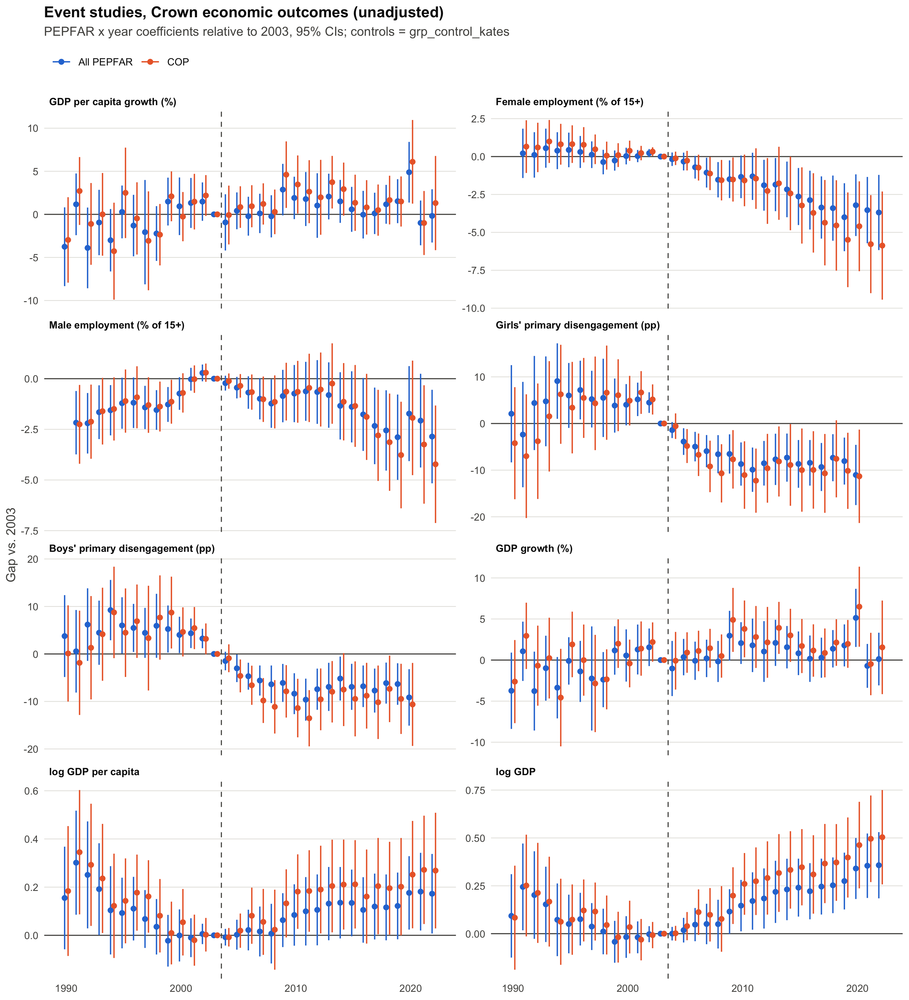

# Event studies: Crown et al. (2023) economic outcomes

Anthony Babu, Oct 2026. Code: `analysis/parallel_trends/event_study_economic.R` (runs in ~10 seconds from the repo root).

## What was run

For each outcome, instead of one PEPFAR × Post coefficient we estimate a separate PEPFAR-vs-control gap for every year, relative to 2003:

```
Y_it = a_i + g_t + sum_{k != 2003} b_k (PEPFAR_i x 1[year = k]) + e_it
```

- Country FE (`a_i`), year FE (`g_t`), SEs clustered by country, 1990–2022.
- Treatment: All PEPFAR (90 countries) and COP (31), each vs. `grp_control_kates` (67 controls minus Venezuela, Colombia, Panama).
- **Unadjusted** and **Adjusted** specs. Adjusted adds the 11 Crown baseline covariates (2003 values) × year dummies. They can't enter on their own with country FE.
- Outcomes: Crown's five (GDP per capita growth, female/male employment, girls'/boys' primary disengagement) plus our three additions (GDP growth, log GDP per capita, log GDP). Disengagement is rescaled to percentage points to match Crown.

How to read a plot: each dot is "how much bigger the PEPFAR–control gap was that year than in 2003." Parallel trends looks fine if the pre-2004 dots hover around 0. An effect shows up as post-2004 dots moving away from 0.

Checks layered on top:

| Check | What it asks |
|---|---|
| Pre-2004 joint test | Are all 13 pre-2004 coefficients jointly zero? Small p means trends were *not* parallel. |
| Linear time trends (slide 3 model) | `+ theta (PEPFAR x t)`: is there still a jump `delta` once PEPFAR countries get their own drift? |
| Country-specific linear trends | Every country gets its own slope. |
| Pre-trend removed | Fit PEPFAR's 1990–2003 trend, extend it forward, subtract it, re-run. |
| Sun–Abraham | Uses each country's own first PEPFAR year (59 of 90 started in 2004, the rest 2005–2016) instead of 2004 for everyone. |
| Robustness | Crown's 1990–2018 window with his control group; drop China & India; balanced countries; winsorized growth (1/99); GDP in levels. |

## Headline results

Average post-2004 coefficient (SE), unadjusted, with the pre-trend test:

| Outcome | All PEPFAR | Pre-test p | COP | Pre-test p | With PEPFAR linear trend (All / COP) |
|---|---|---|---|---|---|
| GDP per capita growth (pp) | 0.92 (1.07) | 0.001 | 1.83 (1.34) | <0.001 | −0.18 (0.83) / 1.05 (0.99) |
| Female employment (pp) | **−2.13 (0.73)** | 0.14 | **−2.76 (0.98)** | 0.07 | 0.34 (0.57) / 0.96 (0.72) |
| Male employment (pp) | −1.38 (0.68) | 0.07 | −1.54 (0.80) | 0.15 | 0.59 (0.66) / 1.14 (0.80) |
| Girls' disengagement (pp) | **−7.31 (1.92)** | 0.002 | **−8.78 (3.02)** | <0.001 | **−7.55 (1.85) / −11.0 (2.74)** |
| Boys' disengagement (pp) | **−6.34 (1.72)** | 0.11 | **−8.63 (2.56)** | 0.001 | **−7.32 (1.74) / −10.7 (2.64)** |
| GDP growth (pp) | 1.04 (1.10) | 0.003 | 2.10 (1.36) | <0.001 | −0.12 (0.86) / 1.16 (1.02) |
| log GDP per capita | 0.09 (0.06) | 0.18 | **0.16 (0.08)** | 0.04 | −0.02 (0.07) / −0.02 (0.09) |
| log GDP | **0.19 (0.06)** | 0.43 | **0.28 (0.08)** | 0.13 | −0.03 (0.07) / −0.03 (0.09) |

Bold = 95% CI excludes zero. Full numbers for every spec are in `es_summary.csv` and `linear_trends.csv`.



### Outcome by outcome

**GDP per capita growth / GDP growth: parallel trends fails, and the effect is fragile.**
- In the early 1990s, PEPFAR countries grew more slowly than controls relative to 2003. By 1999–2002 the gap was already about +1.5, which is the same size as most post-2004 coefficients. So the post period mostly looks like the late pre period.
- Post-2004 gaps are clearly positive only around 2009–2013 (the global recession, which Crown also notes) and in 2020.
- The team's TWFE DiD (1.61, close to Rishad's pooled 1.64) is bigger than the event-study average (0.92). The reason is that DiD compares against the *whole* 1990–2003 average, including the bad early 1990s. This is the "lumping" problem from the slides.
- Once PEPFAR countries get their own linear trend, the All-PEPFAR effect goes to about zero (−0.18). Winsorizing and Sun–Abraham don't change the picture.

**Female employment: clean pre-trends, steady decline after 2004.**
- The pre-period is flat (p = 0.14). After 2004 the gap drifts down every year, to about −3.7 pp by 2022 (COP about −5.8).
- This matches the sign Crown reports and holds across the window, China/India, and Sun–Abraham checks.
- But a linear trend absorbs it entirely, because a gradual decline *is* a trend. That's the "trends can eat a real effect" problem.
- Caveat: these are ILO *modeled* estimates, which are smoothed and partly imputed.

**Male employment: pre-trend problem.**
- The PEPFAR–control gap rises from about −2.2 in 1990 to 0 by 2002, then turns down after 2004. The joint test is borderline (p = 0.07), but the pattern is visibly not flat.
- I wouldn't put weight on this one.

**Primary disengagement (girls and boys): the strongest result, with one real caveat.**
- The gap is large and negative after 2004: −7 to −9 pp, growing to about −10 by 2010.
- It survives linear trends, country-specific trends, Sun–Abraham, the Crown window, and dropping China & India.
- Caveat 1: the joint test rejects, but not because of a long drift. The 1993–2002 coefficients sit flat at about +5, then the gap closes about 4.5 pp between 2002 and 2003, the year before PEPFAR. This isn't a change in which countries report. Among the 54 countries observed in both years, PEPFAR countries fell 1.8 pp while controls rose 0.6.
- Several PEPFAR countries abolished primary school fees in this era (e.g. Uganda 1997, Tanzania 2001, Kenya 2003). That's a likely confounder to rule out.
- Caveat 2: the data are thin (about 1,800 country-years). Restricting to countries observed in most years leaves 25 (All) / 16 (COP) countries. The estimate stays similar (−9.7) but the CIs get wide.

**log GDP per capita / log GDP: U-shaped.**
- PEPFAR countries lost ground in the 1990s, roughly 25–30% relative to controls. The gap was flat 1999–2008, then rose steadily after about 2009, to about +0.17 log points (~19%) for GDP per capita by 2022.
- The slide-3 trend model sends the jump to zero.
- Extending the 1990s decline forward makes the effect look much bigger (+0.32). That's probably wrong, because the decline had stopped by 1999.
- log GDP also picks up faster population growth in PEPFAR countries, so log GDP per capita is the one to read.

### Things that did *not* matter
- **Staggered timing:** Sun–Abraham is almost identical to the common-2004 version for every outcome (`figures/es_sunab_*.png`). Crown's single cutoff isn't driving anything.
- **Dropping China & India:** no visible change.
- **Crown's own window (1990–2018) and control group:** same conclusions.

### The adjusted spec is too noisy to be useful as-is
- Only 104 of 151 countries have all 11 baseline covariates (secondary enrollment and donor health spending are the main gaps).
- Interacting 11 covariates with 32 years adds about 400 parameters. CIs blow up, especially for COP (58 countries), and pre-tests are not better.
- Suggestion: next time use a short list (baseline HIV prevalence, log GDP per capita, life expectancy, region) × year, or × a linear trend.

## Bottom line for the meeting
1. The event studies show the parallel-trends assumption behind Crown's GDP growth result fails, and the result goes away with a PEPFAR-specific trend.
2. Disengagement is the most robust finding. It needs a check against fee-abolition reforms and the 2003 drop.
3. The employment declines are real in the modeled data but indistinguishable from a gradual trend.
4. GDP *levels* diverge after about 2009, but the 1990s pre-period isn't parallel either.

## Files

| File | Contents |
|---|---|
| `figures/es_<outcome>.png` | One per outcome: All PEPFAR and COP panels, unadjusted vs. adjusted |
| `figures/es_overview_unadjusted.png` | All 8 outcomes on one page |
| `figures/es_sunab_{all_pepfar,cop}.png` | Common 2004 start vs. Sun–Abraham |
| `figures/es_detrended_{all_pepfar,cop}.png` | Unadjusted vs. pre-trend removed |
| `figures/robustness_avg_post.png` | Average post-2004 effect across every spec |
| `es_summary.csv` | One row per model: N, countries, pre-test p, average pre/post coefficient, TWFE DiD |
| `es_coefficients.csv` | Every year-by-year coefficient |
| `sunab_coefficients.csv` | Sun–Abraham coefficients by event time |
| `linear_trends.csv` | The three linear-trend models |

## Notes for the team
- `analysis/parallel_trends/event_study.R`, `analysis/replication/ec_outcomes_did.R` and `analysis/specs.R` still reference the old `data/final/country_panel.csv` and old variable names (`gdppc_growth`, `PEPFAR`, `event_time`, `iso3`), so they won't run on the FIXED panel. I left them untouched; the new script replaces the event-study one.
- Sample difference from `did_crown.R`: that script keeps Venezuela, Colombia and Panama as controls. This one uses `grp_control_kates` because the window runs to 2022.
- The pre-trend-removed and linear-trend SEs don't account for uncertainty in the estimated trend, so they are slightly too small.
